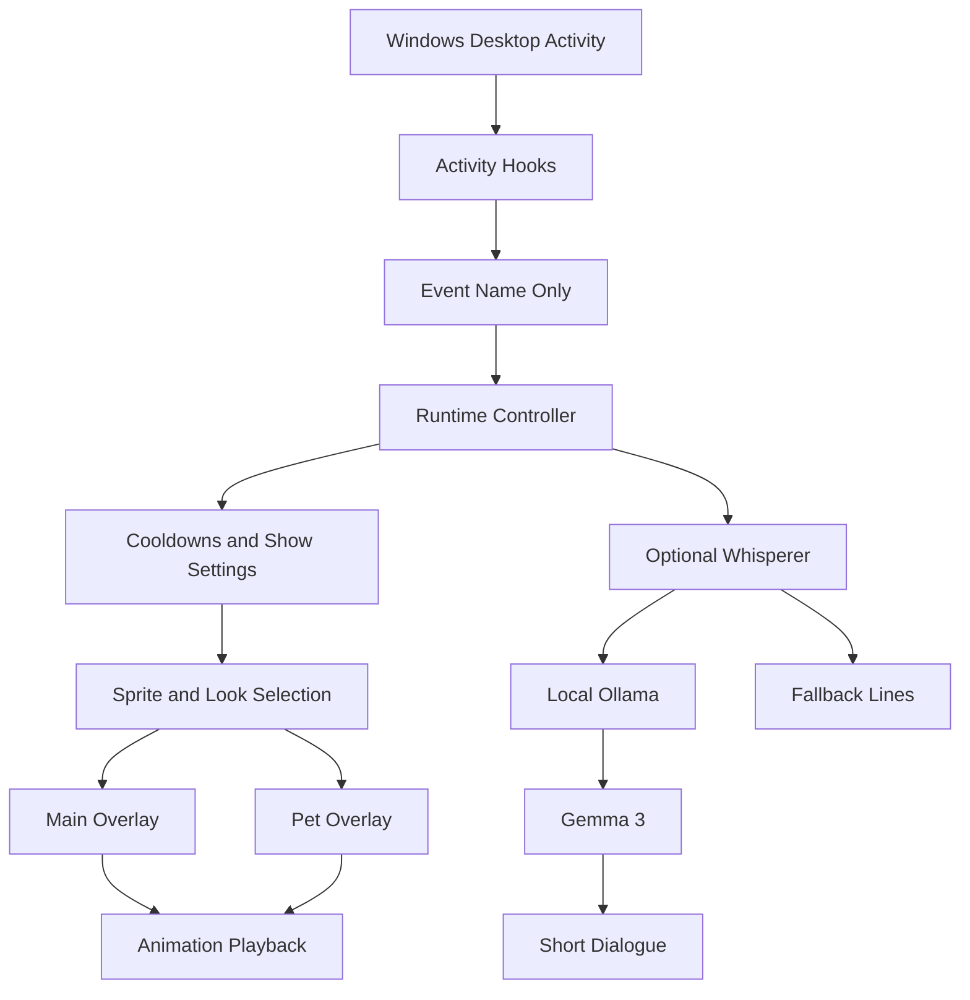

# 👻 Ghost in the Machine (GITM)

### A little ghost. A lot of personality. Always local.

**Ghost in the Machine (GITM)** is a local-first Windows desktop companion that reacts to what you do on your computer.

It stays invisible when nothing is happening. Start typing, copy something, drag a file, or leave your computer idle — and your little ghost briefly appears with an animation. Give it a personality with optional locally powered AI dialogue using Gemma 3.

No cloud account. No permanent mascot covering your screen. Just a tiny ghost that comes alive when your computer does.

---

## 🎬 Watch GITM in Action

<p align="center">
  <a href="https://youtu.be/mtokemH5_Vg">
    
  </a>
  <br>
  <strong>▶ Watch Demo 1</strong>
</p>

<p align="center">
  <a href="https://youtu.be/Od1qMNbtQxE">
    
  </a>
  <br>
  <strong>▶ Watch Demo 2</strong>
</p>

---

## ✨ What Makes GITM Different?

Most desktop companions are always visible, waiting for attention.

GITM takes a different approach.

It observes computer activity through lightweight event detection and reacts only when something interesting happens. Its animations are temporary, its personality is configurable, and its AI interaction can run entirely on your local machine.

- 👻 **Event-driven appearances** — The ghost reacts to typing, copying, dragging, and idle activity.
- 🎭 **Animated personality** — Import your own sprite sheets and customize how the ghost behaves.
- 🧠 **Optional local AI** — Let Gemma 3 generate short contextual dialogue through Ollama.
- 🐾 **Interactive pet mode** — Summon your ghost anywhere on the screen.
- 🎨 **Multiple looks and projects** — Configure different characters and animation sets.
- 🔒 **Privacy-first architecture** — No typed text, clipboard contents, or screen contents are uploaded.
- 🖥️ **Native desktop experience** — A transparent, always-on-top, click-through overlay that doesn't steal focus.

## 🖥️ Two Parts, One Ghost

### 1. Studio — Electron + React

The Studio is the control center for your ghost.

Use it to configure:

- Enable or disable individual reactions.
- Import custom PNG sprite sheets.
- Configure animation size, opacity, and speed.
- Set individual cooldowns.
- Enable or disable Gemma dialogue for each action.
- Manage multiple projects and character looks.
- Configure the ghost's appearance and behavior.

### 2. Engine — Python + Qt

The Engine runs quietly in the Windows system tray.

It handles:

- Keyboard, mouse, clipboard, and folder activity events.
- Animation playback and positioning.
- Transparent desktop overlays.
- Pet behavior and interactions.
- Cooldowns and action configuration.
- Optional local AI dialogue.
- Local progression and state management.

The Studio configures the experience; the Engine brings it to life.

## 👻 Meet Your Ghost

### Typing Reaction

When you start typing, the ghost peeks into your screen from an edge.

It can appear from the left or right at an angle, or upside-down from the top. It stays briefly while you're typing and slides away when you stop.

### Copy & Shortcut Reactions

Copy something or trigger an enabled shortcut, and the ghost reacts with its configured animation.

Each action can have its own visibility setting and AI dialogue permission.

### Drag & Move

When you drag or move something, the ghost can briefly follow the movement.

### Idle Mode

Leave your computer alone for a while, and the ghost can appear with a soft swarm-style animation.

### Interactive Pet Mode

Triple-click anywhere on the screen to summon your ghost at that location.

- Triple-click again to dismiss it.
- Supports up to three visit animation sheets.
- Sometimes strolls near your mouse.
- Walks back home after exploring.
- Runs independently from the main activity overlay.

## 🧠 Local AI Personality — Gemma 3

GITM can optionally use **Gemma 3 through Ollama** to give your ghost a voice.

Each action has two independent controls:

| Setting | Behavior |
|---|---|
| Show | Enables or disables the visual reaction |
| Gemma | Enables or disables AI-generated dialogue |

When Gemma is disabled, the ghost stays silent.

When enabled, it can generate a short contextual line for the current action.

If Ollama is unavailable, GITM falls back to predefined lines from `assets/lines/`.

The AI integration is optional. GITM's core animations do not depend on it.

## 🎨 Bring Your Own Sprites

GITM supports custom PNG sprite sheets.

Import a sprite sheet through Studio, configure its grid, and let the importer split it into individual frames.

The imported frames are saved as a horizontal animation strip with metadata.

Example:

```text
sprites/
└── characters/
    ├── typing/
    │   ├── idle.png
    │   └── idle.json
    ├── copy/
    ├── drag/
    ├── idle/
    └── pet/
        └── visits/
            ├── 0/
            ├── 1/
            └── 2/
```

Missing sprite assets produce warnings instead of crashing the Engine.

Your ghost, your art, your personality.

## 🏗️ Architecture



### Configuration

GITM uses `config.yaml` for live configuration, including:

- Action visibility.
- Sprite configuration.
- Cooldown durations.
- Overlay settings.
- Ollama configuration.
- Character looks.

The Electron Studio communicates with the Python Engine through `app/studio_bridge.py`, using JSON over standard input/output.

A Windows mutex prevents multiple Engine instances from running simultaneously.

## 🔒 Privacy by Design

GITM is designed to keep its activity local.

### What is stored locally?

- Action counts.
- Local progression scores.
- Dust feature data.
- Warnings and application logs.
- Pet and look state.

### What is NOT stored?

- Typed text.
- Clipboard contents.
- Screen contents.
- AI dialogue history.
- Filenames in the dust scoring file.

Clipboard change detection uses an in-memory hash that is discarded when the process exits.

**Network behavior:** The optional AI integration communicates with a local Ollama instance. GITM does not require a cloud account or upload your activity data.

## 👻 Local Progression & Seasonal Personality

Your ghost has a little world of its own.

GITM includes local progression features:

- Ectoplasm.
- Mood.
- Candy.
- Badges.

Its state is saved locally:

```text
%APPDATA%\GhostInTheMachine\state.json
```

It can also change its visual personality according to the calendar:

- October 31 — Halloween tint.
- November 1–2 — Día de los Muertos marigold theme.

Use `preview_date` to test seasonal appearances without changing your system date.

## 🧹 Disk Haunt

GITM also includes an experimental disk-cleanup companion called **Haunt**.

It can identify heavy folders and provide cleanup suggestions.

The optional Sweep Temp action can clean selected temporary data, thumbnails, and the Recycle Bin after confirmation.

It does not suggest deleting sensitive locations such as:

- Windows directories.
- User profile directories.
- Documents.
- Desktop.

Optional TabPFN-based scoring is included in the project requirements.

## 🚀 Getting Started

### Requirements

- Windows.
- Python.
- Node.js and npm.
- Git (recommended).

### 1. Clone the repository

```bash
git clone YOUR_REPOSITORY_URL
cd GITM
```

Replace `YOUR_REPOSITORY_URL` with your actual repository URL.

### 2. Create a Python environment

```powershell
python -m venv .venv
```

### 3. Install Python dependencies

```powershell
.\.venv\Scripts\python.exe -m pip install -r requirements.txt
```

### 4. Install Studio dependencies

```powershell
cd desktop
npm install
```

### 5. Build Studio

```powershell
npm run build
```

Return to the project root:

```powershell
cd ..
```

### 6. Launch GITM

```powershell
.\GITM.bat
```

This launches the Electron Studio and starts the Python Engine in the system tray.

### Optional: Enable local AI dialogue

Install [Ollama](https://ollama.com/) and pull Gemma 3:

```bash
ollama pull gemma3:1b
```

Enable the Gemma option for your desired actions in Studio.

## 🧪 Running Tests

Run the project's Python tests:

```powershell
.\.venv\Scripts\python.exe -m pytest
```

## 📦 Packaging for Windows

Build a packaged executable using:

```powershell
.\build_exe.ps1
```

Expected output:

```text
dist/
└── GITM/
    ├── GITM.exe
    ├── config.yaml
    └── sprites/
```

## 🎮 Quick Controls

| Action | Result |
|---|---|
| Start typing | Typing animation |
| Copy something | Copy reaction |
| Drag or move | Drag reaction |
| Stay idle | Idle animation |
| Triple-click | Summon pet |
| Triple-click again | Dismiss pet |
| Tray → Pause | Pause the Engine |
| Studio → Show off | Disable a specific visual reaction |
| Studio → Gemma off | Disable AI dialogue for that action |

## 📁 Project Structure

```text
GITM/
│
├── main.py
├── GITM.bat
├── config.yaml
├── requirements.txt
├── build_exe.ps1
│
├── app/
│   ├── hooks/
│   ├── overlay/
│   ├── tray/
│   ├── whisper/
│   ├── dust/
│   └── studio_bridge.py
│
├── desktop/
│   └── React + Electron Studio
│
├── sprites/
│   └── characters/
│
└── assets/
    ├── icons/
    ├── lines/
    └── dust/
```

### Local Application Data

GITM stores its application state and logs under:

```text
%APPDATA%\GhostInTheMachine\
```

This includes:

- `state.json`
- `app.log`
- `look.json`
- Dust history.
- Pet state.

## 🛣️ Roadmap

Some areas that can be expanded in future versions:

- [ ] More built-in character personalities.
- [ ] More animation presets and reactions.
- [ ] Expanded sprite customization.
- [ ] Additional local AI personality options.
- [ ] More interactive pet behaviors.
- [ ] Improved seasonal events and progression.
- [ ] More desktop activity reactions.

## 🤝 Contributing

Contributions, ideas, sprite packs, and feedback are welcome!

If you have an interesting character, animation, or idea for a new reaction, feel free to contribute.

You can help by:

- Creating new sprite sheets.
- Improving animation behavior.
- Suggesting new desktop interactions.
- Improving local AI dialogue.
- Reporting bugs and performance issues.

## ❤️ The Idea Behind GITM

Your computer doesn't have to feel lifeless.

Sometimes, a tiny ghost appearing at the right moment is enough to make an ordinary desktop feel a little more alive.

**Ghost in the Machine — A little ghost living inside your machine.**

---

<p align="center">
  Made with 👻 and a little bit of ectoplasm.
</p>
